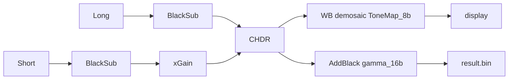

# HDR parameter suggestion (`hdr-suggest`)

From 2 or 3 IMX900 frames (`.bin` AYA or `.raw`), suggest **Black level, Composite gain (dB), Conversion gain, Low/High threshold, Blend, Tone** for the Sony CHDR(2F)/(3F) viewer (or a web equivalent). Frames are ordered **long (brightest) → short**. Implementation: package `hdr_suggest`, console script `hdr-suggest`.

File layout for AYA `.bin` → active `.raw`: see [`aya_bin_to_raw.md`](aya_bin_to_raw.md).

## 1. Viewer model



CHDR, per pixel, after black subtraction (`v = Long - black`):

- `v < Low` → Long
- `v >= High` → Short × G  (keep High ≤ clip_eff − 1; viewer may use `>`)
- `Low <= v < High` → `a × Long + (1 − a) × Short × G`  (`a` = Blend, constant, not a ramp)

`G = 10^(gain_dB/20) × conversion_ratio` (the two fields multiply). Tone mapping is on the display path only.

- One black field for every frame. Tone mapping is display-only (0 = linear, higher lifts darks); default 1.
- Conversion gain is the HG/LG efficiency ratio (slide example 2.6×). Same sensor mode → conversion = **1**; the whole exposure ratio goes into composite dB.
- Single-frame Long/Short views are unreliable (clip ~255 LSB, ignore tone/gain). Gain can only be judged at the seam.
- 2F map colours (from the tool slides): cyan = long, green = blend, red = short.
- 3F Mid–Short thresholds are compared on the **Long-scale composite** (Mid × G_LM). Low/High = Long–Mid Low/High × G_LM, rounded to 100. Confirmed on the `data/3f` set (3430/3730 → 6800/7400).

## 2. CLI

```
hdr-suggest LONG.(bin|raw) [MID.(bin|raw)] SHORT.(bin|raw) [options]
  --black N              black level in LSB (required when no .bin provides OB)
  --bits 12              ADC bits (default 12)
  --margin 120           High = floor((clip_eff-1-margin)/10)*10
  --window 300           Low = High - window
  --exposures a [b] c    optional nominal exposures (ms), same order as files
  --cam-gain-db a [b] c  optional camera gain per frame (dB)
  --json out.json        machine-readable result
```

- Input order is long → short. Do **not** auto-sort; if median brightness disagrees with that order, warn and still analyse in the given order.
- Exit non-zero only on unusable input (wrong size, fewer than 2 frames, no overlapping valid cells). Other issues are warnings in the report.
- Stdout follows the panel order, and every section cites at least one measured number: Black → Composite & Conversion gain → Thresholds → Blend → Tone → Picture select (how to check; not a computed setting).

## 3. Inputs

| source | pixels | black level |
|---|---|---|
| `.bin` (AYA) | `aya_bin_to_raw.md`: u16 W,H then W×H u16; active = rows 41.., cols 0..W−17 | mean of OB rows 1..40, cols 0..W−17 (IMX900: ~240.0 ±0.6 per frame, 12-bit) |
| `.raw` | name `_w<W>_h<H>_<bits>b_<bayer>`; u16 LE, right-aligned; **no OB rows** | `--black`, or OB from matching `.bin` files in the same run; never estimate from image content |

- When black comes from `.bin` files: mean of per-frame OB means, rounded to 0.1. Warn if those means differ by >1.5 LSB (viewer has one field).
- Raw-only runs without `--black`: error (do not assume 240).
- `clip = 2^bits−1` (4095); `clip_eff = clip − black` (3855 at black 240). Raw clip pile-up (`pixel == clip`) confirms it.

## 4. Algorithm

```
black    = given or mean(OB rows) over frames
cell(x)  = 2x2 mean (any Bayer phase; contains R,G,G,B)
C_f      = cell(frame_f - black)
K        = cell(frame_L>=clip)>0 OR cell(frame_S>=clip)>0
for each adjacent pair (L,S):
  valid  = ~K & 30 < C_L < 0.8*clip_eff & 5 < C_S < 0.8*clip_eff
  r_glob = median(C_L/C_S | valid)
  r_seam = median(C_L/C_S | ~K, C_L>30, C_S>5, 0.65*clip_eff < C_L < 0.97*clip_eff)
           # if >=2000 cells else r_glob
  level curve: 15 log bins from 30 to clip_eff; median ratio if bin has >=500 cells
  gain_dB = 20*log10(r_seam)          # report to 0.01 dB
  conversion_ratio = 1
  High   = floor((clip_eff - 1 - margin)/10)*10      # margin 120 -> 3730
  Low    = High - window                              # window 300
  Blend  = 0.5 ; Tone = 1
  area% on Long after black: v<Low, Low<=v<High, v>=High
  short_noise_in_long_LSB = 2.6 * r_seam
chain 3 frames: dB(L,S) = dB(L,M) + dB(M,S)
  Mid-Short Low/High = round(LM * G_LM / 100)*100     # Long-scale; 3430/3730 * 1.987 -> 6800/7400
  area% for Mid-Short: v = (Mid - black) * G_LM
```

NEVER use mean(all pixels) ratio, and NEVER compute dB from typed exposures. Optional `--exposures` / `--cam-gain-db` only for a nominal-vs-measured warning when `|measured − nominal| > 0.5` dB.

## 5. Warnings (non-fatal)

- Long not clipped (`max < clip`): Short adds nothing.
- ratio < 1.5 (frames ~equal) or `High/ratio < 30` LSB (Short at switch too noisy).
- `|dB_seam − dB_glob| > 0.5` or per-level ratio in a bin above `0.4*clip_eff` differs from seam by >5%.
- Short fraction > 40%: Long exposure too long / thresholds too low.
- Black differs between frames by >1.5 LSB.
- Median brightness order disagrees with the given long→short order.
- Gain is valid only for **that capture set**. Lamp flicker (50 Hz mains → 100 Hz ripple) with exposures not a multiple of 10 ms changes brightness; recommend DC light or multiples of 10 ms. Camera gain must be identical across frames, else add the dB difference to `gain_dB`.
- 3F Mid–Short thresholds are Long-scale; print Mid-unit fallback 3430/3730.

## 6. Output (JSON)

```json
{"black":239.7,"clip_after_black":3855.3,"black_source":"ob",
 "pairs":[
   {"name":"long_mid","gain_dB":5.96,"ratio_seam":1.987,"conversion_gain_ratio":1,
    "low":3430,"high":3730,"unit":"longer-frame LSB","blend":0.5,"tone":1},
   {"name":"mid_short","gain_dB":5.97,"ratio_seam":1.988,"conversion_gain_ratio":1,
    "low":6800,"high":7400,"unit":"Long-scale","fallback_mid_units":[3430,3730],
    "blend":0.5,"tone":1}],
 "chain_dB":11.93,
 "warnings":[]}
```

## 7. Worked example (`data/3f`)

All sample frames live in `data/3f/`. There is no separate 2F capture set; for CHDR(2F) pass long + short only.

**3F**
```
uv run hdr-suggest data/3f/long-13p2-9db.bin data/3f/mid-6p6-9db.bin data/3f/short-3p3-9db.bin \
  --exposures 13.2 6.6 3.3 --cam-gain-db 9 9 9
```

Acceptance (12-bit, black ~240, clip_eff ~3855):

- Two pairs, composite gain near 6 dB each (±0.15 dB), conversion 1, reported to 0.01 dB.
- Long–Mid: low 3430, high 3730. Mid–Short: low 6800, high 7400 (Long-scale).
- Blend 0.5, tone 1, per-pair long/blend/short area %.
- OB means ~238.9 / 239.9 / 240.5 → spread warning; suggested black = mean rounded to 0.1.
- Chained long→short dB = sum of the two pair dB values.

**2F (same folder, skip mid)**
```
uv run hdr-suggest data/3f/long-13p2-9db.bin data/3f/short-3p3-9db.bin \
  --exposures 13.2 3.3 --cam-gain-db 9 9
```

Acceptance: one pair, composite gain ~11.95 dB (±0.15), low/high 3430/3730, Long clips (~7%), Short used in highlights.

Viewer check of this 3F set (screenshots, not decoded by tests): [`data/3f/viewer/hdr-3f.png`](data/3f/viewer/hdr-3f.png) and [`data/3f/viewer/map-3f.png`](data/3f/viewer/map-3f.png). Composite uses black 240, gains 5.96/1 and 5.97/1, thresholds 3430/3730 and 6800/7400, blend 0.5/0.5, tone 0 (linearity). Map uses the same idea with gains rounded to 6 and Long–Mid thresholds 3400/3700, tone 1. On that map, red is Long (most of the frame), purple is Mid (brighter chart patches), cyan is Short (the two white patches), and orange/yellow rims are the blend zones.

## 8. Older verification vectors (camera gain 0 dB)

| pair (long / short) | ratio seam | dB seam | dB global |
|---|---|---|---|
| Mid10 / Short1.2 | 6.86 | 16.7 | 17.0 (7.09) |
| Long20 / Mid10 | - | 6.3 | 6.4 (×2.08) |
| Mid10 / Short1 | - | 19.9 | 20.1 (×10.1) |
| Short5 / Short1 | 5.06 | 14.1 | 15.0 (×5.48; warn level-dependent) |

Viewer settings that worked on a 2F set: Black 240, Gain 16.9, Conversion 1, Low 3000, High 3500, Blend 0.5, Tone 1. Pink/odd colours on clipped white card disappear when High ≤ 3854.
